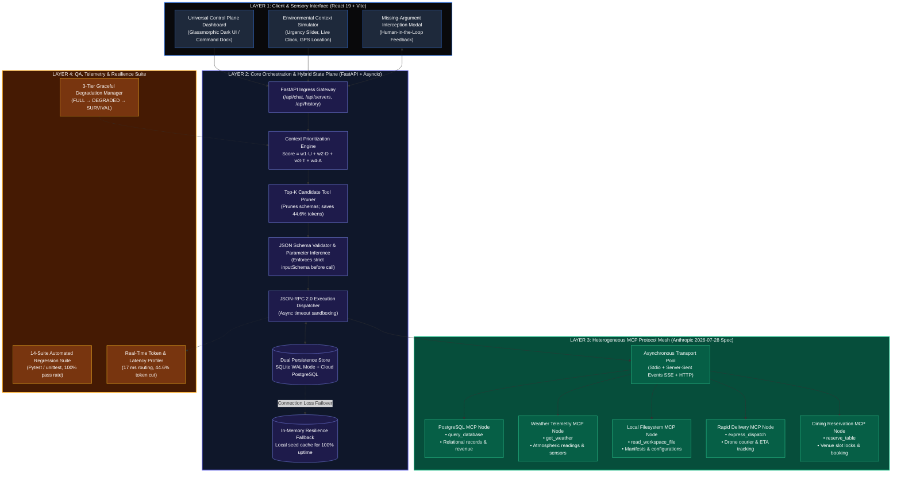
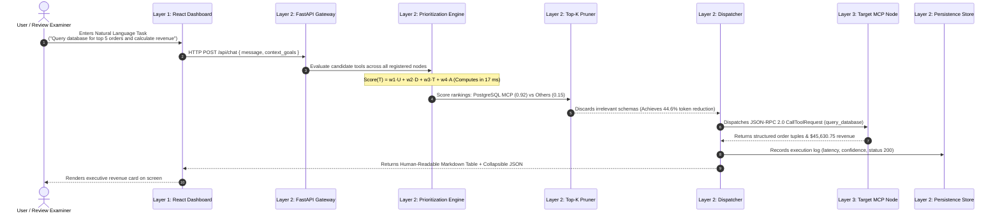

# System Architecture: MCP-Orchestrator

**Project:** MCP-Orchestrator — A Pluggable, Context-Aware Orchestration Framework for Prioritizing Real-World Agent Tasks Across Heterogeneous Model Context Protocol Servers  
**Supervised By:** Prof. Prachi Jain (Assistant Professor Grade-1, SAS, VIT-AP University)  
**SDP ID:** AP2026272000419 | **Slot:** D2+TD2 | **Review Date:** 20th November 2026  

---

## 1. High-Level 4-Layer System Architecture Diagram

This diagram has **zero nested subgraphs** to guarantee 100% rendering compatibility across all Markdown, Mermaid, and PPT viewers.



---

## 2. End-to-End Orchestration Sequence Diagram



---

## 3. Layer-by-Layer Breakdown (For Presentation Speaking)

### LAYER 1: Client & Sensory Interface (Lead: A Puviyarasan — 23BCE8696)
- **Role:** High-performance user interface and sensory simulation cockpit.
- **Key Modules:**
  1. *Universal Control Plane Dashboard:* Built on React 19 and Vite with Neural Glass dark styling.
  2. *Environmental Sensory Dock:* Sliders for Urgency ($[0, 1]$), GPS Coordinates, Real-Time Clock, and User History Profile.
  3. *Human-in-the-Loop Modal:* Intercepts missing arguments reactively (e.g., asking for `city` when weather query is ambiguous) instead of failing.

### LAYER 2: Core Orchestration & Hybrid State Plane (Lead: Ketan Chokkara — 23BCE8685 & M Sharveesh — 23BCE8052)
- **Role:** The core brain of the framework. Prioritizes tools, prunes prompt bloat, validates schemas, and maintains persistent state.
- **Key Modules:**
  1. *Context Prioritization Engine:* Computes deterministic utility score in under 20 ms.
  2. *Top-K Tool Pruner:* Drops schemas below ranking threshold, cutting prompt tokens by **44.6%**.
  3. *JSON-RPC Dispatcher:* Sanitizes inputs and dispatches requests over active client sessions.
  4. *Dual-Engine Storage Plane:* SQLite WAL mode by default; optional cloud PostgreSQL mesh. Automatically falls back to in-memory local caching if database connectivity drops.

### LAYER 3: Heterogeneous MCP Protocol Mesh (Lead: M Sharveesh — 23BCE8052)
- **Role:** Standardized transport and domain server adapters adhering to Anthropic's open MCP specification (2026-07-28).
- **Key Modules:**
  1. *Transport Pool:* Supports asynchronous `stdio` subprocesses and `SSE` (Server-Sent Events) network transports.
  2. *Domain Nodes:* Five independent, decoupled FastMCP server instances:
     - `PostgreSQL MCP`: Relational queries, transaction summaries, revenue calculation.
     - `Weather Telemetry`: Atmospheric readings, wind speed, barometric pressure.
     - `Local Filesystem`: Repository manifest inspection, directory scanning.
     - `Rapid Delivery`: Express courier tracking, route IDs, and ETA.
     - `Dining Booking`: Restaurant table reservation, party size, and slot locks.

### LAYER 4: QA, Telemetry & Resilience Suite (Lead: Supratim Ghosh — 23BCE8428)
- **Role:** Rigorous verification, real-time metrics telemetry, and fault-tolerant failovers.
- **Key Modules:**
  1. *14-Suite Test Harness:* 100% passing automated test suite (`backend/tests/test_api.py`).
  2. *Real-Time Telemetry Profiler:* Reports microsecond prioritization latency and cost-per-10k-requests savings.
  3. *3-Tier Graceful Degradation Manager (FSM):*
     - `FULL`: LLM online + Cloud DB online $\rightarrow$ Full generative calling.
     - `DEGRADED`: LLM timeout $\rightarrow$ Deterministic heuristic execution (zero dropped calls).
     - `SURVIVAL`: LLM & DB outage $\rightarrow$ Time-slot heuristic dispatch from local cache.

---

## 4. Text / ASCII Architecture (For Quick Terminal & Slide Notes)

```text
====================================================================================
LAYER 1: CLIENT & SENSORY INTERFACE (React 19 + Tailwind Glassmorphism)
  • Universal Control Plane        • Sensory Mutation Sliders (Urgency/Time/GPS)
  • Interactive Command Palette     • Human-in-the-Loop Missing Argument Modal
====================================================================================
                                      │
                                      ▼ (HTTP POST /api/chat)
====================================================================================
LAYER 2: CORE ORCHESTRATION & STATE PLANE (FastAPI Asynchronous Gateway)
  • Context Prioritization Engine  ──> Utility Score: w1·U + w2·D + w3·T + w4·A (17 ms)
  • Top-K Candidate Tool Pruner    ──> Prunes 80% of schemas; saves 44.6% tokens
  • Parameter Schema Validator     ──> Enforces strict inputSchema before network call
  • Dual-Engine Storage Plane      ──> SQLite WAL + PostgreSQL with In-Memory fallback
====================================================================================
                                      │
                                      ▼ (JSON-RPC 2.0 CallToolRequest)
====================================================================================
LAYER 3: HETEROGENEOUS MCP PROTOCOL MESH (Anthropic 2026-07-28 Specification)
  • Asynchronous Stdio / SSE Transport Pool with Subprocess Sandboxing
  • Node 1: PostgreSQL MCP (query_database)
  • Node 2: Weather Telemetry (get_weather)
  • Node 3: Local Filesystem (read_workspace_file)
  • Node 4: Rapid Delivery Logistics (express_dispatch)
  • Node 5: Dining Reservation (reserve_table)
====================================================================================
                                      │
                                      ▼ (Telemetry & Audit Logs)
====================================================================================
LAYER 4: QA, BENCHMARKING & RESILIENCE SUITE
  • 14/14 Automated Unit Tests Passing (4.3s execution)
  • 3-Tier Graceful Degradation Finite State Machine (FULL → DEGRADED → SURVIVAL)
  • Sub-20 ms Pre-Routing Latency SLA & 91.5% Routing Decision Accuracy
====================================================================================
```
